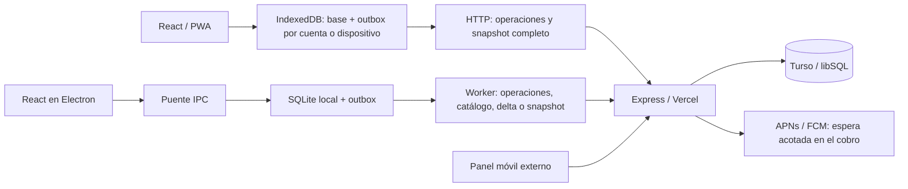

# Auditoría de arquitectura, integridad y escalabilidad — Mi Tienda

Fecha: 18 de octubre de 2026. Objetivo: evaluar el crecimiento a 100 tiendas.
Base revisada: `501f2c528a2f272fb8b6d44815c006aa18b64d60`, incluyendo los cambios locales preexistentes de escritorio enumerados en [verificacion.json](verificacion.json).

## Dictamen

La estructura general es adecuada para seguir evolucionando: una interfaz compartida, una API modular por rutas y persistencia local permiten operar con conexión intermitente. No hay evidencia que justifique sustituir React, Express o Turso ni dividir el producto en microservicios.

**No recomendaría ampliar todavía a 100 tiendas.** Los bloqueos principales son la sincronización completa del historial, varias garantías de integridad que difieren entre web y escritorio, y el control de acceso. El número de tiendas por sí solo resultó menos determinante que el historial acumulado de cada una.

Se ejecutaron **542 pruebas existentes, todas satisfactorias**, y la PWA compiló. Los diagnósticos adicionales reprodujeron problemas que esas suites no cubren. Dos riesgos críticos dependen de la configuración o del aprovisionamiento: no se comprobó que estén presentes en producción.

## 1. Arquitectura observada



La PWA ya contiene un motor de negocio y almacenamiento propios; no es solamente una interfaz que llama a la API. Electron tiene otro motor local. Por tanto, compartir JSX no garantiza compartir reglas. Las tres implementaciones de ventas, cierres y sincronización son hoy el principal coste de mantenimiento y una fuente comprobada de diferencias.

En la API, `user_id` representa la tienda y `account_id` al operador. Sin embargo, la tienda se modela como la cuenta del dueño y la sesión de Electron guarda `publicUser.id` como `user_id`, aunque ese valor identifica a la cuenta. Es una ambigüedad relevante para relevos y futuras sucursales. La existencia de dos sucursales en el plan comercial no demuestra un modelo de sucursales independiente en el almacenamiento.

Fortalezas comprobadas:

- El descuento condicional de stock y las transacciones del servidor impiden sobreventa de productos por pieza en el escenario probado: ocho solicitudes sobre cinco unidades dieron cinco `201`, tres `409` y stock final cero.
- Cinco peticiones concurrentes con el mismo identificador produjeron una única venta en el servidor. El índice único es una garantía real de almacenamiento.
- Una tienda diferente no pudo vender el producto de otra en el diagnóstico; las suites existentes también cubren aislamiento y roles. Esto no equivale a certificar cada consulta de todo el sistema.
- PWA y Electron guardan operación y trabajo pendiente de sincronización de forma atómica. La PWA conserva operaciones rechazadas y contempla respuestas perdidas y cambios de cuenta.
- Los dispositivos compartidos tienen validación de membresía y revocación en el servidor. El puente Electron usa `contextIsolation` y deshabilita `nodeIntegration`.
- CI ejecuta pruebas de servidor, cliente, integración y escritorio, además de compilar la PWA.

## 2. Hallazgos priorizados

Prioridades: **P0** exige cerrar una condición explotable antes de un despliegue expuesto; **P1** compromete integridad, autorización o crecimiento y debe resolverse antes de ampliar tiendas; **P2** es deuda que debe programarse. “Reproducido” significa confirmado en fixtures temporales, no en datos de clientes.

| ID | Prioridad | Hallazgo | Evidencia |
|---|---|---|---|
| A01 | P0 condicional | El registro público puede reclamar un correo administrador todavía libre | Reproducido |
| A02 | P0 condicional | Falta de `JWT_SECRET` activa una clave conocida incluso en producción | Inspección; configuración remota no comprobada |
| A03 | P1 | El token ordinario de un cajero eliminado sigue autorizando operaciones | Reproducido |
| A04 | P1 | Editar únicamente el precio puede restaurar stock vendido concurrentemente | Reproducido |
| A05 | P1 | Reposición de escritorio sin idempotencia y pasadas de sincronización solapables | Reproducido |
| A06 | P1 | Ventas de escritorio pierden la fecha original al sincronizar | Contrato reproducido |
| A07 | P1 | El cobro local de Electron ignora el identificador de idempotencia del cliente | Reproducido |
| A08 | P1 | Los conflictos de escritorio se reintentan y pueden bloquear la cola posterior | Reproducido |
| A09 | P1 | Snapshot y proyección de PWA crecen con todo el historial | Medido |
| A10 | P2 | Las migraciones forman parte del arranque de cada instancia serverless | Medido e inspeccionado |
| A11 | P2 | El cursor de extracciones puede dejar de avanzar | Reproducido con página reducida |
| A12 | P2 | Proyecciones de costos y ganancias inconsistentes según el acceso del cajero | Reproducido |
| A13 | P2 | El vencimiento del plan se aplica en la interfaz, no en cada operación | Reproducido; limitación ya documentada |
| A14 | P2 | Identidad, sesión y capacidades de Electron difieren de la PWA | Reproducido e inspeccionado |

### A01. Aprovisionamiento de administración

`server/routes/auth.js:45` permite registrar cualquier correo sin verificar su propiedad; `server/middleware/auth.js:59` concede administración si el correo guardado está en `ADMIN_EMAILS`. En una base temporal, registrar desde la ruta pública el correo configurado permitió consultar `/api/admin/shops` con `200`.

**Condición:** el correo privilegiado debe estar libre. No demuestra que se pueda tomar una cuenta administradora ya existente ni que esto haya sucedido en producción. Afecta especialmente a nuevas instalaciones y a correos añadidos después a la configuración.

**Corrección:** aprovisionar administradores por un procedimiento confiable, impedir que el registro y la creación de cajeros reclamen esos identificadores, y representar el privilegio mediante un atributo controlado del servidor. Añadir pruebas de arranque y registro con correos reservados.

### A02. Clave JWT de desarrollo disponible en producción

`server/config.js:1` usa una clave literal si falta `JWT_SECRET`; el módulo de base de datos sí valida sus variables en producción, pero el secreto no tiene una validación equivalente. Con ese fallback un tercero que conozca el código puede producir firmas aceptadas. No se leyeron secretos ni se verificaron las variables del despliegue real.

**Corrección:** rechazar el arranque de producción cuando falte una clave válida; conservar el fallback exclusivamente en desarrollo y pruebas. La comprobación debe incluir el entrypoint serverless. Si se descubre uso del fallback en un entorno real, rotar e invalidar sesiones.

### A03. Revocación de cuentas ordinarias

`requireAuth` (`server/middleware/auth.js:21`) confía en los IDs y el rol del JWT ordinario, emitido por 30 días (`server/routes/auth.js:21`), sin comprobar que la cuenta siga existiendo. La validación adicional solamente se aplica a tokens de dispositivos compartidos. Tras borrar un cajero, su token obtuvo productos con `200` y registró una venta con `201`; quedó un `account_id` eliminado y `account_email = null` por el fallback de `server/lib/account.js:16`.

**Corrección:** validar cuenta, pertenencia a tienda y versión de sesión en el middleware; invalidar al eliminar o desactivar una cuenta. El funcionamiento offline puede conservar recibos pendientes, pero el servidor debe resolver explícitamente si los acepta o exige conciliación después de revocar el acceso.

### A04. Actualización de precio que pisa stock concurrente

En `server/routes/products.js:292` se lee el producto fuera de una transacción; el `UPDATE` de la línea 341 reescribe también el stock aunque solo se haya pedido cambiar el precio. El diagnóstico intercaló una venta confirmada entre la lectura y la actualización: stock inicial 100, venta de una unidad, edición de precio; stock final **100 en vez de 99**.

**Corrección:** actualizar solo los campos solicitados; reservar la escritura de stock absoluto para ajustes explícitos con control de versión. Lectura y auditoría de una reposición deben pertenecer a la misma transacción que el incremento. Añadir la intercalación del diagnóstico como regresión. La ruta específica de operaciones PWA tiene otras protecciones, pero la ruta ordinaria sigue siendo usada por Electron y otros clientes.

### A05. Reposición duplicable y concurrencia de sincronización

Electron envía `product.update` a `PUT /api/products/:id` sin el identificador de operación del outbox (`desktop/src/sync/syncWorker.js:76`). Repetir `add_stock: 5` después de perder una respuesta lleva 100 → 110, cuando la recepción fue de cinco unidades. La PWA tiene recibos en `pwa_product_operations`; Electron no utiliza esa garantía.

Además, `syncOnce` puede ser llamado por el loop y por rutas locales (`desktop/src/router.js:158`, `:195`, `:397`). Cada pasada ejecuta `resetStuckSyncing`, que rescata todas las filas en vuelo (`desktop/src/db/queries.js:1851`), sin distinguir un proceso anterior de otra pasada todavía activa. Dos pasadas solapadas del diagnóstico enviaron **dos PUT para una sola reposición local**.

**Corrección:** serializar todas las entradas a `syncOnce`, recuperar operaciones abandonadas al iniciar el proceso o mediante una concesión con vencimiento, y transmitir una clave estable que el servidor guarde con la mutación en una transacción. Se necesitan las tres medidas: exclusión local, recuperación segura e idempotencia remota.

### A06. Fecha de venta offline alterada en la nube

La venta local tiene `created_at`, pero el payload de `sale.create` y su petición no incluyen `sold_at` (`desktop/src/db/queries.js:636`; `desktop/src/sync/syncWorker.js:117`). En `server/routes/sales.js:245` una fecha ausente termina usando la hora de recepción. El diagnóstico envejeció una venta local y comprobó que su petición seguía sin fecha.

**Impacto:** una venta realizada antes de medianoche y sincronizada al día siguiente aparece en otro día en los reportes remotos, aunque el registro local conserve su fecha. **Corrección:** persistir y enviar la hora de ocurrencia original en todas las operaciones monetarias, con el mismo criterio de zona horaria y límites que usa la PWA. Probar reconexión después de medianoche y después de varios días.

### A07. Idempotencia distinta en IPC y HTTP

`desktop/src/db/queries.js:545` genera siempre un UUID nuevo y no reutiliza `client_sale_id` recibido. Dos llamadas locales con el mismo ID del cliente guardaron dos ventas. Cada una se sincronizaría una sola vez, pero ya serían dos ventas diferentes: la idempotencia del servidor no resuelve la duplicación inicial.

**Corrección:** aceptar el ID estable del cobro en IPC, almacenarlo con restricción única y devolver el recibo existente al repetirlo. Probar una respuesta IPC perdida después de confirmar la transacción local. Conservar generación local para clientes antiguos que no lo proporcionen.

### A08. Conflictos que ocupan toda la ventana FIFO

`getPendingOutbox` selecciona `pending` y `conflict`, ordena por ID y limita a 50 (`desktop/src/db/queries.js:106`). El worker vuelve a enviar los conflictos. En el diagnóstico, 50 conflictos generaron 100 peticiones en dos pasadas; la operación 51 permaneció pendiente y nunca fue seleccionada. Esto contradice la descripción de que los conflictos quedan aparcados para revisión.

**Corrección:** separar el trabajo automáticamente reintentable de los conflictos en revisión; no dejar que estos consuman toda la ventana de selección. Bloquear únicamente dependencias que realmente requieran resolver el conflicto y permitir el resto. Añadir espera creciente con variación aleatoria a errores transitorios y una forma explícita de reconciliar recibos monetarios.

### A09. Histórico completo en cada sincronización y lectura local costosa

`server/routes/pwaSync.js:13` descarga ventas y líneas sin paginación para el dueño. La proyección de dispositivos compartidos también descarga su histórico completo (`server/lib/sharedSnapshot.js:11`). El cliente solicita un snapshot al finalizar cada sincronización y activa el ciclo cada 20 segundos, además de eventos de conexión y foco (`client/src/lib/offlineClient.js:241`, `:375`).

La base y el outbox se guardan en una sola clave de IndexedDB; cada lectura local llama a `project`, que clona toda la base (`client/src/lib/offlineModel.js:87`), incluso al consultar productos. La escritura local y el reconocimiento de operaciones también trabajan sobre ese objeto creciente.

**Medidas:** 6.000 ventas con cinco líneas ocuparon 7.065.573 bytes de JSON; 73.000 ventas, 87.193.577 bytes. El snapshot tardó aproximadamente 262 ms y 3.284 ms de mediana local, respectivamente. Solo clonar la base sin operaciones pendientes costó 31,73 ms y 448,56 ms. No se midió el coste adicional de IndexedDB ni un teléfono de gama baja.

La respuesta de 30 días ya supera el límite documentado de 4,5 MB para cuerpos ordinarios de Vercel Functions. Es un riesgo de despliegue sustentado en tamaño y documentación, no un error observado contra producción. [Límites de Vercel Functions](https://vercel.com/docs/functions/limitations).

**Corrección:** carga inicial paginada y sincronización incremental con revisiones, borrados y correcciones; descarga histórica a demanda sin perder la cobertura exacta de caja; almacenamiento local por entidad y outbox separado, conservando la atomicidad. Incorporar límites de bytes y pruebas de crecimiento del historial. No basta con aumentar memoria o comprimir el JSON.

### A10. DDL y errores esperados en el camino de arranque

`server/api/index.js:12` llama a `initDb` una vez por instancia, no una vez por despliegue. Con el esquema ya actualizado se midieron **68 llamadas a `execute`, tres a `executeMultiple` y 63 errores capturados**, principalmente por columnas existentes. Las migraciones capturan cualquier excepción como si fuera una columna duplicada (`server/db/database.js:465`, `:592`).

La mediana local de 2,76 ms no representa el coste remoto: hay numerosas esperas secuenciales y DDL repetido al escalar instancias. Además, si la promesa inicial falla queda memoizada y no se reintenta en esa instancia.

**Corrección:** migraciones numeradas ejecutadas en un paso controlado de despliegue, con bloqueo, versión y rollback probado; arranque limitado a validar compatibilidad y conexión. Distinguir errores de duplicidad de errores de red, permisos o SQL. Medir cold starts reales antes de fijar un presupuesto de latencia.

### A11. Cursor de extracciones sin progreso

En `server/routes/sync.js:73`, el predicado `(id > cursor OR cash_close_id IS NULL)` se combina con orden ascendente y `LIMIT`. Si suficientes extracciones antiguas siguen abiertas, ocupan siempre la página y las nuevas no llegan a verse; `has_more` permanece verdadero. Con `limit=2`, tres extracciones abiertas y dos solicitudes se recibieron `[1,2]` ambas veces y el cursor quedó en 2. El worker usa páginas de 500 y un máximo de diez páginas por pasada: el umbral real es mayor, pero el defecto es el mismo.

**Corrección:** separar el avance incremental de la actualización del conjunto abierto, o usar un registro de cambios paginable por revisión. Probar más de 500 extracciones abiertas y exigir avance del cursor o fin de página, sin ciclos infinitos.

### A12. Proyección de costos inconsistente

Un cajero ordinario recibió `purchase_price=60` en `/api/products` y `/api/sync/snapshot`, y `profit=40` en la respuesta de creación de una venta. La proyección compartida sí elimina el precio de compra (`server/lib/sharedSnapshot.js:9`) y `sharedSaleResponse` solo quita ganancia si la petición es compartida (`server/lib/sharedDevices.js:30`).

**Corrección:** acordar explícitamente qué costos y márgenes puede conocer cada rol y aplicar la misma proyección en HTTP, snapshots, IPC y almacenamiento descargado. Ocultar controles en React no protege datos ya entregados. No se debe asumir que todos los cajeros tienen prohibido conocer costos sin confirmar esa regla de negocio.

### A13. Bloqueo comercial limitado a la UI

Después de vencer la prueba en un fixture, `/api/auth/me` informó `locked=true`, pero crear una venta devolvió `201`. `RequireAuth` aplica el bloqueo en React; el middleware no consulta el estado del plan. El README ya declara esta limitación.

**Corrección:** definir una política del servidor para operaciones nuevas y una política separada para recibos legítimos cobrados offline antes del vencimiento. El bloqueo no debe provocar que ventas ya cobradas desaparezcan o queden imposibles de conciliar. Añadir pruebas de expiración durante una jornada y de sincronización posterior.

### A14. Identidad, sesión y diferencias funcionales en Electron

El guard de `desktop/src/auth.js:48` compara IDs de cuentas y puede rechazar al segundo cajero de la misma tienda como si fuese otra tienda. El diagnóstico lo reprodujo con una respuesta de login simulada. La protección depende además de que exista la sesión anterior: llamar al logout exportado y entrar con otra cuenta deja visibles productos y ventas de la base anterior. Es una debilidad del módulo, no una ruta de logout publicada por IPC.

La UI borra el token de `localStorage` al salir, pero no limpia la sesión SQLite; al abrir de nuevo, `loadMe` consulta esa sesión local (`client/src/context/AuthContext.jsx:51`, `:167`; `desktop/src/router.js:46`). Debe definirse el cierre de sesión local y el relevo sin perder operaciones pendientes.

También falta paridad de paquetes: SQLite local no almacena `pack_size/pack_price` y una llamada IPC con `pack_size=12` descuenta una unidad y calcula costo unitario. La UI normal de Electron no ofrece el paquete si el catálogo local no tiene esos campos; el diagnóstico demuestra una diferencia de contrato, no una venta errónea observada en esa pantalla.

**Corrección:** separar `shop_id`, `account_id` y `register_id`, fijar una vinculación persistente de la base a la tienda y hacer que el logout no borre esa identidad. Versionar capacidades y ejecutar pruebas de contrato equivalentes sobre los tres motores.

## 3. Rendimiento, escalabilidad y costes

### Método y resultados

Mac arm64, Node 24.7.0, Express en proceso y libSQL sobre archivos temporales. Se poblaron 10, 50 y 100 tiendas con 100 productos y 6.000 ventas por tienda, cinco líneas por venta. Después se amplió **solo una tienda** a 73.000 ventas; las otras 99 conservaron 30 días. El fixture final tenía 667.000 ventas y 3.335.000 líneas sintéticas, más operaciones pequeñas de los diagnósticos.

El histórico se simplificó a un cierre acumulado válido por tienda; no se modelaron miles de arqueos, rechazos ni correcciones. Los tokens del benchmark son exclusivamente de fixtures. No hubo acceso a producción ni peticiones al backend real.

| Operación | 10 tiendas, mediana | 50 tiendas, mediana | 100 tiendas, mediana | Tamaño JSON por respuesta |
|---|---:|---:|---:|---:|
| Snapshot de una tienda con 30 días | 267,32 ms | 266,52 ms | 261,92 ms | 7,07 MB |
| Dashboard de una tienda | 2,05 ms | 1,48 ms | 1,58 ms | 2,35 kB |
| Delta de hasta 500 ventas y un cierre | 33,25 ms | 32,56 ms | 33,10 ms | 613,33 kB |

| Ráfaga de dashboard sobre fixture de 100 tiendas | p50 local | p95 local | Éxitos |
|---|---:|---:|---:|
| 10 solicitudes concurrentes | 9,40 ms | 16,91 ms | 10/10 |
| 50 solicitudes concurrentes | 41,13 ms | 78,13 ms | 50/50 |
| 100 solicitudes concurrentes | 84,38 ms | 154,70 ms | 100/100 |

Los endpoints individuales se midieron tres o cinco veces y cada ráfaga una sola vez. Los percentiles del JSON de evidencia describen esas muestras pequeñas; **no son un SLO ni una prueba sostenida de capacidad**. Los tamaños son JSON UTF-8 sin compresión, en unidades decimales. Los tiempos no incluyen Internet, TLS, proxies, cold starts ni latencia de Turso. No se cargaron 100 tiendas con un año cada una ni se probaron 200 terminales reales.

### Consultas y serialización

- Una venta de una línea realizó nueve `execute`; una de cinco líneas, 21, además de abrir y confirmar transacción. La ruta contiene lecturas, descuentos e inserciones por línea y espera las notificaciones antes de responder. Agrupar instrucciones y reducir consultas debe conservar las garantías de stock y precios históricos.
- El dashboard principal ejecutó 14 consultas secuenciales. La latencia local baja no representa 14 esperas hacia un servidor remoto. Agrupar lecturas independientes o usar un lote consistente es una mejora medible antes de introducir cachés.
- `EXPLAIN QUERY PLAN` utilizó índices por tienda, lo que ayuda a explicar la estabilidad al aumentar tenants. La delta ordenada por ID utilizó `idx_sales_user_created` y un árbol temporal. Conviene probar un índice `(user_id,id)` con el SQL exacto y medir el coste de escritura antes de añadirlo. No todos los árboles temporales justifican un índice: ordenar 100 productos es secundario frente a transferir todo el historial.
- SQLite se usa de forma síncrona en el proceso principal de Electron. Operaciones grandes pueden bloquear IPC y ventana. Es un riesgo por diseño, aún sin perfil de una caja real; medirlo antes de mover cálculos a otro proceso.

### Tráfico y presupuesto

Si cada sincronización de un cliente descargase el snapshot de 7,07 MB y completase un ciclo cada 20 segundos durante 12 horas, serían 2.160 snapshots y unos **15,26 GB de JSON por cliente y jornada**. Para 200 clientes con ese mismo tamaño, el máximo teórico del escenario sería unos 3,05 TB diarios, antes de compresión. Los cajeros pueden tener una proyección menor, la conexión puede alargar los ciclos y este tráfico no fue medido en producción. El cálculo muestra la amplificación evitable del protocolo.

Con el supuesto de 100 tiendas × 200 ventas/día × cinco líneas, se generan 600.000 ventas y tres millones de líneas al mes, más los descuentos de stock, índices, auditoría y cierres. Las cuotas deben presupuestarse con mediciones de filas leídas/escritas, bytes y solicitudes; no solo con el número de tiendas. Turso factura capacidad y uso por varias dimensiones y las lecturas facturadas pueden superar las filas devueltas según el plan de consulta. [Precios y dimensiones de Turso](https://turso.tech/pricing?frequency=monthly), [explicación de lecturas y escaneos](https://turso.tech/blog/tips-for-maximizing-your-turso-billing-allowances-48a0fca163e9).

No se estimó una factura exacta: se desconocen plan contratado, regiones, configuración, consumo actual y compresión efectiva.

## 4. Operación, seguridad y mantenimiento adicionales

| Área | Observación y consecuencia | Siguiente comprobación o mejora |
|---|---|---|
| Abuso de autenticación | No se encontró limitador de intentos en el código; `bcrypt.hashSync/compareSync` bloquean el event loop durante cada cálculo. Podría existir protección externa no visible. | Verificar WAF y límites efectivos; limitar por cuenta/origen y pasar el trabajo de contraseña a una ejecución que no bloquee el servidor. |
| HTTP del escritorio | `desktop/src/sync/apiClient.js:11` no establece un plazo de cancelación propio. El siguiente tick espera a que termine el actual y una cola hace peticiones secuenciales. | Añadir timeout explícito, cancelación y backoff sin descartar recibos. No se afirma que `fetch` carezca de cualquier timeout interno. |
| Push en el cobro | `notifySale` espera hasta cuatro segundos y usa `Promise.race`; el límite no cancela los transportes subyacentes. | Separar envío mediante outbox de notificaciones y ejecución duradera compatible con serverless; medir latencia con push activado. |
| Observabilidad | Hay `console.error`, pero no se encontró instrumentación de latencias, antigüedad del outbox, errores por tienda o correlación de solicitudes. | Registrar identificadores de operación, tiempos y tamaños sin datos sensibles; alertar por desfase de sincronización y errores persistentes. |
| Respaldo y recuperación | La migración de planes hace una copia de usuarios. No se encontró un procedimiento integral de restauración probado. Puede haber PITR o respaldos gestionados fuera del repositorio. | Verificar retención contratada y hacer un simulacro de restauración con conciliación de outboxes. Registrar RPO/RTO acordados. |
| CI y distribución | Servidor usa `npm install`; otras tareas usan `npm ci`. Servidor se prueba con Node 20/22 y cliente/escritorio con 24. No hay prueba CI del instalador real. | Fijar runtime soportado y lockfiles; probar apertura del instalador, ABI nativa, actualizaciones y compatibilidad de datos. No se auditó un binario distribuido a clientes. |
| Dependencias nativas | El checkout tenía SQLite compilado para Windows x64: las pruebas locales fallaron hasta compilar una copia para el Mac. El hook local de empaquetado ya contempla reconstrucción y no fue modificado. | Mantener entornos/builds por plataforma e incluir una prueba que abra realmente SQLite. No confundir este fallo ambiental con un fallo funcional del producto. |
| Frontend | El build concentró 512,92 kB de JS, 137,58 kB gzip; `App.jsx` importa páginas estáticamente. | Separar rutas menos frecuentes sin romper el precache y la navegación offline. Es una mejora secundaria respecto al histórico. |
| Superficie de navegador | CORS es global; no se observó una política CSP propia del producto. Tokens ordinarios y bundles de caja se guardan en almacenamiento accesible por JavaScript. | Revisar orígenes necesarios, cabeceras del hosting, navegación/IPC y exposición ante XSS. El PIN local no cifra los tokens ni protege frente a acceso al perfil del navegador. |
| Modelo monetario | Importes son `REAL` y se redondean en varias implementaciones. Las pruebas de pagos cubren escenarios relevantes, pero la duplicación eleva el riesgo de divergencia. | Consolidar funciones puras de dinero/unidades y límites; añadir casos de importes grandes y contratos cruzados antes de considerar una migración de representación. |

No se hizo un escaneo de vulnerabilidades con una base actualizada de avisos, una auditoría del panel móvil externo ni una inspección de las cuentas de Vercel/Turso. No se atribuyen CVE ni se certifican respaldos o protecciones externas a partir del código.

## 5. Hoja de ruta y criterios de salida

Los esfuerzos siguientes son orientativos para una persona que conozca el código y deben validarse al diseñar cada cambio. Son propuestas; esta auditoría no los implementa.

| Orden | Trabajo | Esfuerzo orientativo | Validación de salida |
|---|---|---|---|
| 1 | Cerrar A01/A02 y revocar cuentas ordinarias correctamente | 1–2 días | Sin privilegios por registro público; producción sin clave no arranca; cajero revocado no puede crear operaciones nuevas. |
| 2 | Corregir A04 y A05 | 2–3 días | Precio concurrente no cambia stock; respuesta perdida y dos workers no duplican una recepción. |
| 3 | Unificar IDs, fechas y selección del outbox; A06–A08/A11 | 2–4 días | Un recibo local por ID; fecha original conservada; cola con conflictos y más de 500 extracciones progresa sin perder dependencias. |
| 4 | Reemplazar snapshot periódico por sincronización acotada e incremental; A09 | 4–7 días | Sin cambios, el volumen transferido no crece con el histórico; paginación limitada por bytes; correcciones y borrados llegan; actualización de PWA conserva cola y cobertura de cierres. |
| 5 | Sacar migraciones del arranque y formalizar identidad/capacidades; A10/A12–A14 | 3–5 días | Arranque sin DDL; migraciones repetibles y reversibles; mismo contrato de roles, tienda y funciones entre clientes. |
| 6 | Observabilidad, recuperación y validación en infraestructura equivalente | 2–4 días | Restauración ensayada; métricas por operación; pruebas de latencia/coste remoto con carga representativa y cero pérdida/duplicación. |

Las fases tienen dependencias y partes combinables: los rangos no son una promesa de calendario ni una estimación de una reescritura. Mantener Express como monolito modular, extraer reglas puras compartibles y usar pruebas de contrato ofrece un camino más acotado que cambiar de stack. Evaluar una base por tienda u otra tecnología solo si métricas reales de contención, aislamiento, restauración o coste lo justifican.

Antes de abrir 100 tiendas, ejecutar en un entorno aislado equivalente a producción: tráfico sostenido y ráfagas de lectura/escritura, reconexión simultánea de cajas, cliente antiguo frente a API nueva, 365 días de datos, migración de IndexedDB con cola pendiente y restauración de base seguida de reintentos. Los objetivos p95, presupuesto y ventana offline deben acordarse con datos reales del negocio; esta prueba local no los certifica.

## Evidencias y reproducción

- [Resultados completos de API, consultas y carga sintética](resultados.json).
- [Resultados de contratos y colas de Electron](resultados-desktop.json).
- [Comandos, pruebas existentes y particularidades del entorno](verificacion.json).
- [Diagnóstico reproducible de API y rendimiento](diagnosticos.cjs).
- [Diagnóstico reproducible de escritorio](diagnosticos-desktop.cjs).

Desde la raíz del repositorio, con las dependencias instaladas:

```sh
node docs/auditoria-2026-10-18/diagnosticos.cjs /private/tmp/mypimes-audit-results.json
node docs/auditoria-2026-10-18/diagnosticos-desktop.cjs /ruta/a/desktop /private/tmp/mypimes-audit-desktop-results.json
```

El segundo comando requiere `better-sqlite3` compilado para el Node anfitrión. En esta auditoría se copiaron `desktop/src` y sus pruebas a una carpeta temporal, se compiló allí el módulo nativo usando cabeceras locales y se ejecutaron las 132 pruebas, preservando el binario y los cambios de trabajo originales. Los scripts establecen el transporte de pruebas sin puertos; las bases son temporales. Son diagnósticos de este estado del código, no sustitutos de nuevas pruebas de regresión después de corregirlo.

No se modificaron los flujos de la aplicación, no se ejecutaron migraciones sobre bases existentes y no se inició ni detuvo ningún servidor. Se añadieron únicamente los documentos, scripts y resultados de esta auditoría; el build regeneró artefactos ignorados de la PWA.
